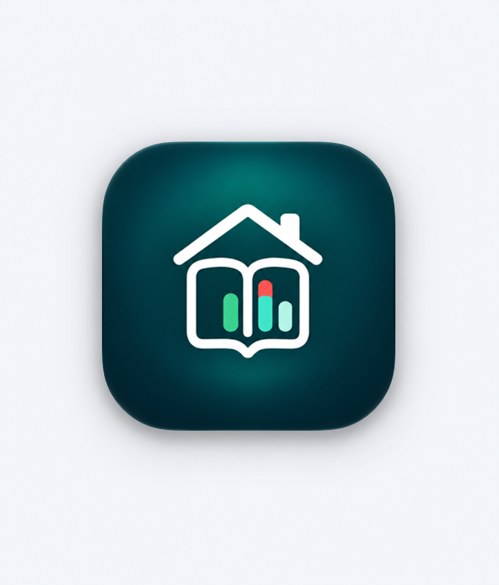
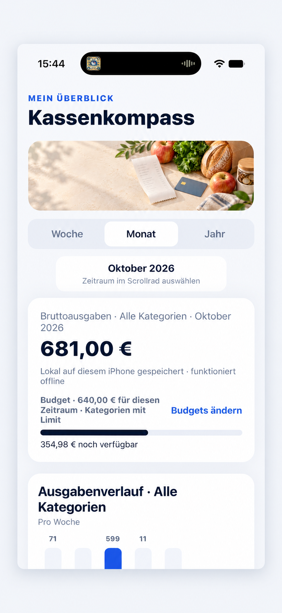
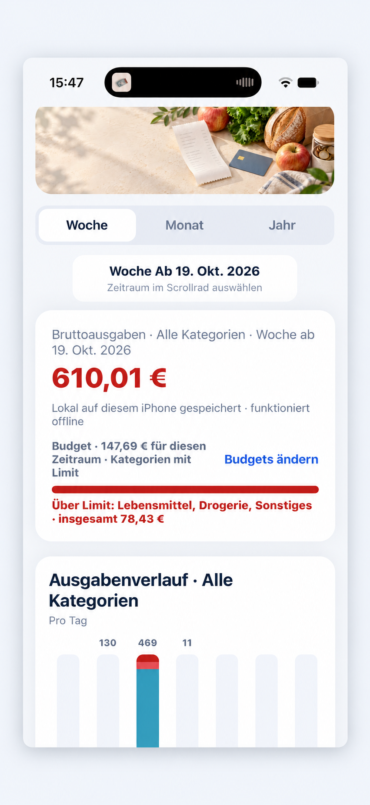
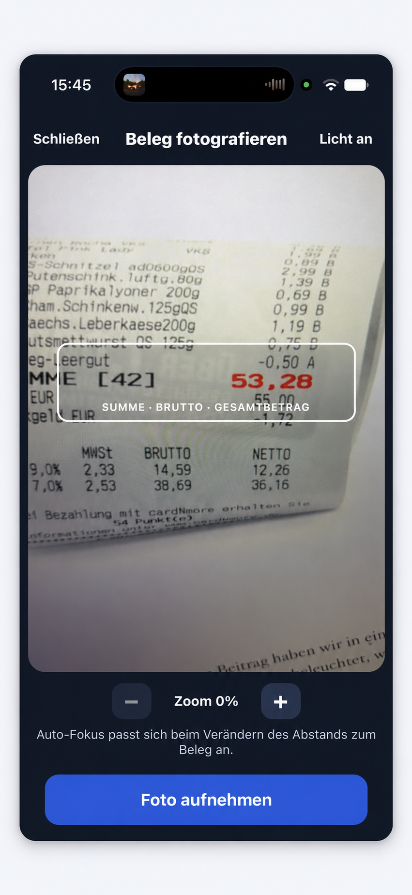
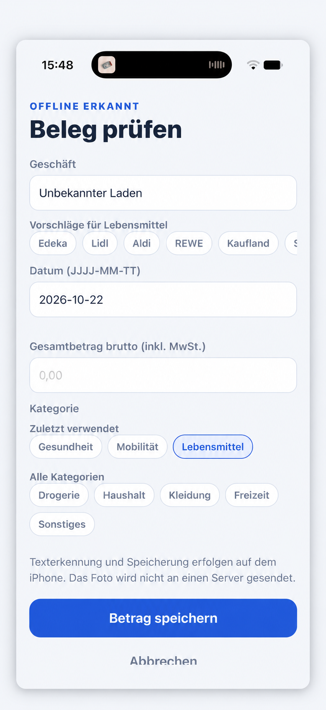
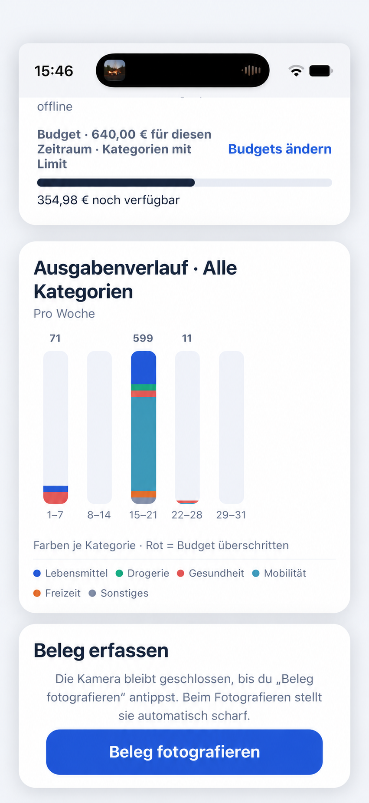
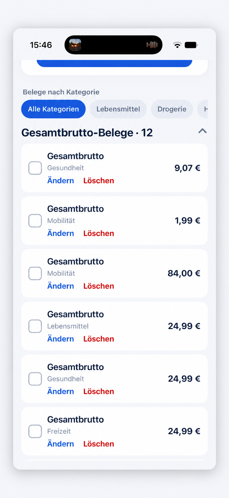
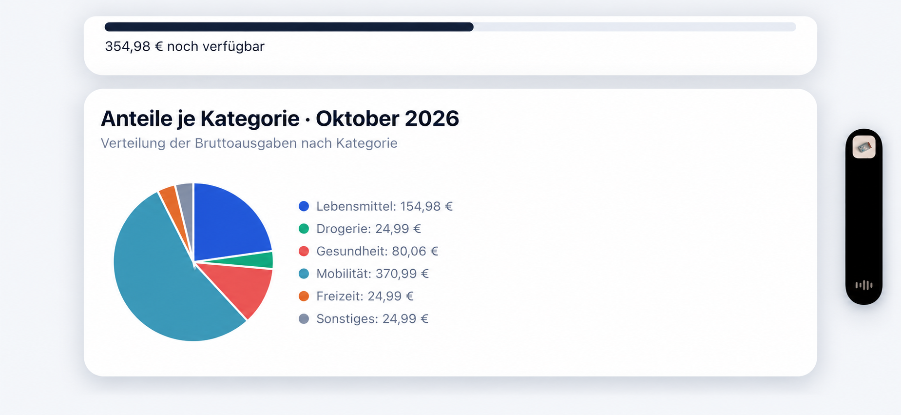

# Kassenkompass

**Vom Kassenbon zum Ausgabenüberblick.**

Meine iPhone-App für Belegerfassung, Ausgabenübersicht und Budgets – entwickelt mit Unterstützung von ChatGPT und Codex, auf dem iPhone erprobt.

## Die Idee

Wohin geht mein Geld im Alltag? Kassenkompass hilft dabei, Belege zu erfassen, Ausgaben nach Kategorien zu ordnen und das eigene Budget im Blick zu behalten.

Dieses Repository präsentiert die App mit Screenshots und Einblicken in ihre Entwicklung. Der App-Quellcode wird hier nicht veröffentlicht.

## Was die App kann

- **Belege fotografieren:** Kameraansicht mit Orientierungshilfe, Licht- und Zoomsteuerung.
- **Erkannte Angaben prüfen:** Geschäft, Datum, Gesamtbetrag und Kategorie vor dem Speichern bearbeiten.
- **Ausgaben kategorisieren:** Beispielsweise Lebensmittel, Drogerie, Gesundheit, Mobilität und Freizeit; zuletzt verwendete Kategorien und Geschäftsvorschläge erleichtern die Eingabe.
- **Zeiträume vergleichen:** Wochen-, Monats- und Jahresansicht sowie Auswahl vergangener Zeiträume.
- **Budgets verfolgen:** Kategorienbudgets, verbleibende Beträge und Hinweise auf Überschreitungen.
- **Ausgaben visualisieren:** Verlauf als Balkendiagramm und Verteilung als Kreisdiagramm.
- **Belege verwalten:** Nach Kategorien filtern, Einträge ändern oder löschen.

Laut App erfolgt die Texterkennung und Speicherung lokal auf dem iPhone; Belegfotos werden dafür nicht an einen Server gesendet. Die App ist für die Offline-Nutzung ausgelegt.

## Ein Rundgang durch die App

### 1. Überblick und Budget

Die Startansicht verbindet Zeitraum, Ausgaben und Budgetinformationen.

 

### 2. Beleg fotografieren und Angaben prüfen

Die Kamera öffnet auf Knopfdruck. Nach der Aufnahme können die erkannten Angaben geprüft und korrigiert werden.

 

### 3. Ausgaben verstehen und Belege verwalten

Farben machen Kategorien im Verlauf unterscheidbar. Die Belegliste ermöglicht Änderungen und das Löschen von Einträgen.

 

Die Screenshots zeigen unterschiedliche Ansichten und Aufnahmestände der App.

## Entwickelt mit KI – gelernt durch Testen

Ich habe Kassenkompass mit Unterstützung von **ChatGPT** entwickelt. Ich habe Funktionen beschrieben, Vorschläge ausprobiert und die Ergebnisse auf meinem iPhone überprüft. Xcode wurde für den iOS-Build und die Installation verwendet; die App basiert auf React Native und Expo.

Die größte Herausforderung war, aus KI-generierten Vorschlägen eine funktionierende App zu machen:

| Herausforderung | Anpassung und Erfahrung |
|---|---|
| Belegerkennung fand den Gesamtbetrag nicht zuverlässig | Die Auswertung wurde angepasst, damit „SUMME“ und Beträge auch über benachbarte Textzeilen zugeordnet werden können. |
| Roter Startbildschirm: „No script URL provided“ | Eine Release-Version mit eingebettetem JavaScript ermöglichte den Start ohne laufenden Entwicklungsserver auf dem Mac. |
| Xcode-Build und Installation scheiterten zeitweise | Abhängigkeiten, der richtige Workspace, Dateizugriffsrechte und Apple-Signierung mussten geprüft und eingerichtet werden. |
| Ein KI-Vorschlag enthielt einen Konfigurationsfehler | Die CocoaPods-Konfiguration musste korrigiert und erneut geprüft werden. |
| Budgetwarnungen waren zu pauschal | Überschreitungen wurden je Kategorie berechnet und die Darstellung entsprechend verfeinert. |

**Meine wichtigste Erfahrung:** Vibe Coding hilft, Ideen umzusetzen. Testen, Fehler verstehen und Ergebnisse kritisch prüfen bleiben ein wesentlicher Teil der Entwicklung.

## Projektstand

Persönliches Entwicklungsprojekt und Portfolio-Präsentation. Die App wurde auf einem iPhone installiert und erprobt. Dieses Repository bietet keine Installationsdatei und keine App-Store-Veröffentlichung an.

---

Entwickelt von [Stefan Kümmel / PaceLLM](https://github.com/PaceLLM).
